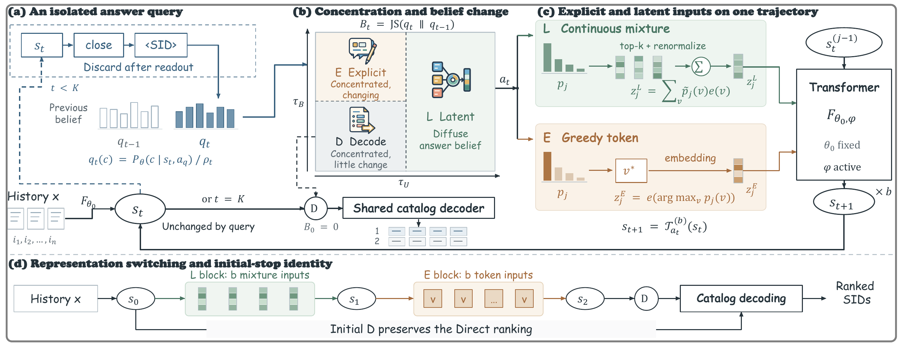

# Belief-Guided Dynamic Explicit-Latent Reasoning for Generative Recommendation

This repository contains the anonymous implementation of **DynR<sup>2</sup>**.

## Method Overview

DynR<sup>2</sup> adapts both the representation and the length of intermediate reasoning to the evolving recommendation. At each decision boundary, an isolated answer query estimates a belief over catalog-valid first SID codes while preserving the current reasoning state. Belief uncertainty and change guide the choice between explicit continuation, latent continuation, and final SID decoding.

Explicit reasoning appends greedily selected token embeddings; latent reasoning appends probability-weighted top-k token embeddings. Both extend the same accumulated trajectory. Response-side LoRA adapts the continued computation while keeping history encoding and the initial direct predictor fixed.



## Setup

Use Python 3.10 or later and CUDA-enabled PyTorch with bfloat16 support.

```bash
python3 -m venv .venv
source .venv/bin/activate
python -m pip install -e '.[pipeline]'
```

Dependencies are declared in `pyproject.toml`. Integration checks use Python 3.12, PyTorch 2.10.0, Transformers 5.13.0, and PEFT 0.20.0.

Models, adapters, checkpoints, and results are stored outside this repository. Set the artifact directory before running any stage:

```bash
export DYNR2_ARTIFACT_ROOT="$(dirname "$PWD")/DynR2-artifacts"
```

Without this variable, the launchers use a sibling directory named `<repository-name>-artifacts`. Checkpoint writes inside the source repository are rejected.

For multi-GPU initial-model training with DeepSpeed, also install:

```bash
python -m pip install -e '.[distributed]'
```

## Data And Model

The experiments use the Amazon Reviews 2014 5-core categories:

- **Beauty** (`Beauty`)
- **Sports and Outdoors** (`Sports`)
- **Toys and Games** (`Toys`)

Raw and processed datasets and model weights are not redistributed. All preprocessing, model download, initial training, and DynR<sup>2</sup> entry points below are included in this repository. Run the commands from the repository root.

### 1. Data Preprocessing And SID Construction

Prepare all three categories:

```bash
python run_generate_data.py --category Beauty
python run_generate_data.py --category Sports
python run_generate_data.py --category Toys
```

For each category, preprocessing executes the following stages in order:

1. `download`: obtain the Amazon Reviews 2014 review and metadata files.
2. `sid`: construct chronological sequences, encode item metadata, and fit residual k-means codebooks to generate four-layer SIDs. The shared tokenizer uses four codebooks with 256 codes per layer and 30 k-means iterations.
3. `hnsw`: construct SID topology and the supervised chronological data splits used for initial-model training.

The entry point also accepts `--category all`. Individual phases can be run with `--phase download`, `--phase sid`, or `--phase hnsw`. Generated assets include `item_embeddings.npy`, `codebooks.npz`, `sid_codes.npy`, `item_mapping.json`, and supervised data files under `data/processed/<Domain>/`. The final phase also writes the DynR<sup>2</sup> training inputs under `data/<Domain>/`, including a seeded checkpoint-selection validation subset and training-history counts.

### 2. Base Model

Download Qwen3-1.7B and its tokenizer:

```bash
python model/download_basemodel.py
```

The downloader stores the model and its tokenizer in `$DYNR2_ARTIFACT_ROOT/model/Qwen3-1-7B/`. Vocabulary expansion adds the four layers of SID tokens and their begin/end markers. The language tokenizer is reused; the item semantic tokenizer is fitted during SID construction.

### 3. Initial Recommender Training

Train the initialization stages for each category:

```bash
set -e
for domain in Beauty Sports Toys; do
  bash run_train.sh --stage expand --category "$domain" --gpus 4
  bash run_train.sh --stage align --category "$domain" --gpus 4
  bash run_train.sh --stage merge --category "$domain" --gpus 4
  bash run_train.sh --stage rec --category "$domain" --gpus 4
  bash run_train.sh --stage sid_routing --category "$domain" --gpus 4
done
```

These stages expand the SID vocabulary, align SID-token representations with item metadata, train history-to-SID recommendation, and apply supervised SID-transition training. The transition model is initialized from the validation-selected direct recommendation checkpoint. Its selected checkpoint is automatically exposed at `$DYNR2_ARTIFACT_ROOT/models/<Domain>/initial/` for DynR<sup>2</sup> response adaptation. Per-stage validation records are saved under `$DYNR2_ARTIFACT_ROOT/outputs/<name>_initial/`.

For a fresh initialization, the same sequence can be run with `bash run_train.sh --stage all --category Beauty --gpus 4`; replace `Beauty` with `Sports`, `Toys`, or `all` as needed. The expanded vocabulary is shared across domains. Existing training and merged-model outputs are not overwritten. Set `USE_DEEPSPEED=0` to use native distributed training instead of the default DeepSpeed ZeRO-2 configuration.

## DynR<sup>2</sup> Inputs

Preprocessing and initial training produce the following inputs for each `<Domain>` in `Beauty`, `Sports`, and `Toys`:

```text
$DYNR2_ARTIFACT_ROOT/
  models/<Domain>/
    initial/                      SID-trained model weights, config, and tokenizer
data/
  <Domain>/
    item_mapping.json             Static item-to-SID mapping
    train.parquet                 Response-adaptation training examples
    model_selection.parquet       Checkpoint-selection validation examples
    test.parquet                  Test examples
    train_history_counts.json     Counts from visible training histories
```

Examples target each user's third-last, penultimate, and final interactions for training, validation, and testing, respectively. Histories preserve the temporal order of preceding item identifiers, titles, and categories. Keep checkpoint-selection validation examples separate from test examples, and save visible-training-history item counts as `train_history_counts.json`.

Preprocessing writes `training_sid_routing_train.parquet`, `training_sid_routing_val.parquet`, and `training_sid_routing_test.parquet` under `data/processed/<Domain>/`, preserving the reference history formatting and SID labels. It also exports the files above with original target item identifiers. `model_selection.parquet` contains a fixed validation subset for response-checkpoint selection. DynR<sup>2</sup> packs histories to a maximum of 4,000 tokens for response training and evaluation.

Each example contains these fields:

| Field | Description |
| --- | --- |
| `sample_id` | Unique example identifier within the file |
| `user_id` | User identifier |
| `description` | Text describing the preceding interaction history |
| `groundtruth` | Target SID, including its begin and end markers |
| `target_item` | Target catalog item identifier, required for exact-item metrics |

The catalog and history counts use item identifiers as keys:

```json
{
  "item_001": {"sid": "<|sid_begin|><s_a_0><s_b_2><s_c_3><s_d_4><|sid_end|>"},
  "item_002": {"sid": "<|sid_begin|><s_a_1><s_b_2><s_c_3><s_d_5><|sid_end|>"}
}
```

```json
{"item_001": 12, "item_002": 3}
```

Each SID code and marker must be a single token in the corresponding model's tokenizer. Initial training exports the full model configuration, weights, and matching tokenizer through `$DYNR2_ARTIFACT_ROOT/models/<Domain>/initial/`. When reusing existing experiment artifacts, preserve each domain's original model, SID mapping, validation cohort, and tokenizer alignment.

## Training And Evaluation

Run the following commands from the repository root after activating the environment. Dataset names are case-sensitive.

```bash
export GPUS=4
```

### 1. Response Training

Train the response adapter for each dataset:

```bash
bash scripts/run.sh Beauty train
bash scripts/run.sh Sports train
bash scripts/run.sh Toys train
```

Training saves every epoch's adapter, including epoch zero. Checkpoint selection uses validation NDCG@10 averaged over explicit and latent paths at depths one through four, with unit decoder weights and temperatures. Exact-item targets use exact-item NDCG; SID-only targets use SID NDCG. Ties select the earliest checkpoint. The selected adapter is recorded in `$DYNR2_ARTIFACT_ROOT/outputs/<name>_train/training.json`.

### 2. Test Evaluation

Load the selected adapter and evaluate each dataset:

```bash
bash scripts/run.sh Beauty test
bash scripts/run.sh Sports test
bash scripts/run.sh Toys test
```

The launcher reads `selected_adapter` from the training summary automatically. Test evaluation uses the corresponding domain configuration and averages request latency over three repeats. It does not repeat training or change the selected checkpoint.

### 3. Complete DynR<sup>2</sup> Run

After preparing the inputs and initial model, perform response training, checkpoint selection, and test evaluation in sequence for a fresh run:

```bash
bash scripts/run.sh Beauty
bash scripts/run.sh Sports
bash scripts/run.sh Toys
```

The commands run sequentially. Existing output directories are not overwritten. After completing the separate training and test stages, do not run the complete command against the same outputs.

## Results

Outputs are organized by dataset:

```text
$DYNR2_ARTIFACT_ROOT/outputs/
  beauty_train/
    epoch_0/                      Initial response adapter
    epoch_1/                      Adapter after the first epoch
    epoch_2/
    epoch_3/
    training.json                 Validation scores and selected adapter
  beauty_test/
    metrics.json                  Aggregate ranking metrics and request latency
    predictions.jsonl             Per-example predictions and reasoning traces
  sports_train/
  sports_test/
  toys_train/
  toys_test/
```

The three result files are:

```text
$DYNR2_ARTIFACT_ROOT/outputs/beauty_test/metrics.json
$DYNR2_ARTIFACT_ROOT/outputs/sports_test/metrics.json
$DYNR2_ARTIFACT_ROOT/outputs/toys_test/metrics.json
```

Each `metrics.json` reports HR and NDCG at 5, 10, and 20 under `sid`, and under `item` when exact-item targets are provided. It also records mean and p95 complete-request latency. Invalid predictions remain in the evaluation population. `predictions.jsonl` contains candidate rankings, per-example scores, reasoning traces, and request timings.
